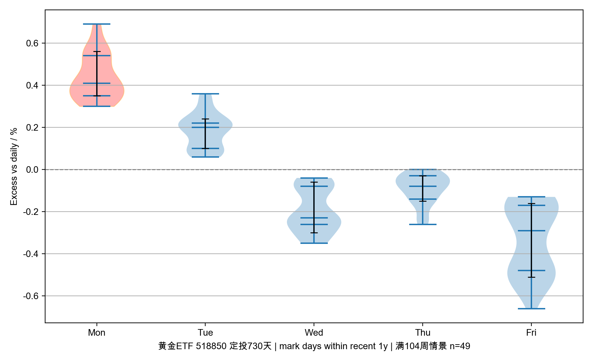

<h1 align="center">
  <br>
  <a href="https://github.com/doongz/ChickenFarm"></a>
</h1>
<h4 align="center">一家小小的养鸡场（定投回测版） </h4>

<p align="center">
    <a>
      
    </a>
    <a>
      
    </a>
    <a href="https://github.com/doongz/ChickenFarm/graphs/commit-activity">
      
    </a>
    <a href="https://github.com/doongz/ChickenFarm/issues">
      
    </a>
    <a href="https://github.com/doongz/ChickenFarm/pulls">
      
    </a>
    <a>
      
    </a>
    <a>
      
    </a>
</p>
<p align="center">
  <a href="#features">Features</a> •
  <a href="#installation">Installation</a> •
  <a href="#usage">Usage</a> •
  <a href="#%E5%AE%9A%E6%8A%95%E5%88%86%E6%9E%90">定投分析</a> •
  <a href="#%E6%97%A5%E5%86%85%E6%8B%A9%E6%97%B6">日内择时</a> •
  <a href="#%E9%A1%B9%E7%9B%AE%E7%BB%93%E6%9E%84">项目结构</a> •
  <a href="#license">License</a>
</p>

非专业养鸡场:hatching_chick::hatched_chick::baby_chick:，一个纯回测工具：维护回测标的清单，爬取场外基金累计净值与场内 ETF 前复权日线，使用定投算法在多个时间跨度上做历史回测，并通过显著性检验与小提琴图回答「周几定投更划算」。:chart_with_upwards_trend::chart_with_upwards_trend::chart_with_upwards_trend:

> 仅用于个人学习与研究，不构成任何投资建议。

## Features

- **行情采集**：场外基金历史净值（[xalpha](https://github.com/refraction-ray/xalpha)）；ETF 日线以新浪财经为主源、akshare 东方财富兜底，含指数退避重试与分红/拆分前复权合成
- **定投回测**：30/60/90/180/365/730 天六个周期，统一估值日盯市、完整交易周对齐、等间隔采样估值日；场外基金按固定金额买入、ETF 按固定手数（1 手=100 份）买入，计入价差/佣金/滑点/申购费折扣
- **统计检验**：工作日配对 Wilcoxon 符号秩检验 + Holm 多重比较校正、bootstrap 95% 置信区间、分时间块稳健性判定
- **图表与数据导出**：按领域导出小提琴图（含中位数/分位/最佳定投日/CI 误差线），并导出 p 值、效应量、CI、稳健性结论 CSV
- **日内择时**：采集 ETF 1 分钟分时并长期累积，以「当日 VWAP」为基准做配对超额分析，回答「一天中什么时刻买入平均成本最低」，含配对 Wilcoxon 检验、bootstrap CI 与分块稳定性判定（详见 [docs/intraday_backtest.md](./docs/intraday_backtest.md)）

## Installation

### 1、准备数据库（SQLite，零安装）

数据存储使用 Python 内置的 **SQLite**：无需安装或启动任何数据库服务、无需账号密码，整个数据库就是一个本地文件，在首次运行时于 `DB_PATH`（默认 `data/chickenfarm.db`）自动创建，全部数据表也会自动建立。

### 2、填写配置文件

复制根目录的 [.env.example](./.env.example) 为 `.env`，填写图表导出目录；`DB_PATH` 与回测参数（`BACKTEST_` 前缀）为可选项，缺省使用代码内默认值。

```shell
cp .env.example .env
```

`.env` 已被 `.gitignore` 忽略，不会提交。

### 3、安装依赖（uv）

无需配置 `PYTHONPATH`，在**仓库根目录**直接运行脚本即可。

```shell
# 创建独立的虚拟环境（Python 3.10+）
uv venv --python 3.10
# 激活环境（macOS/Linux）
source .venv/bin/activate

uv pip install -r requirements.txt
```

或使用 pip：

```shell
python3 -m pip install -r requirements.txt
```

配置文件默认读取仓库根 `.env`；如需自定义位置，可设置环境变量：

```shell
export FARM_CONFIG_PATH=/your/path/.env
```

> [!IMPORTANT]
>
> 每年需要更新一下 chinesecalendar 包，并保持 xalpha 为最新版本：
>
> ```bash
> pip install -U chinesecalendar xalpha
> ```

## Usage

所有命令均在仓库根目录执行，主命令互斥，一次只能执行一个。

| 命令 | 说明 |
| :-- | :-- |
| `chick.py -add -c <code>` | 添加回测标的，运行后按提示选择所属领域（只需添加一次） |
| `chick.py -delete -c <code>` | 从回测标的清单删除（执行前需 `Y` 确认） |
| `chick.py -fetch` | 采集行情：场外基金累计净值 + ETF 前复权日线，为回测提供数据 |
| `chick.py -backtest` | 运行回测并将结果写入 `db_backtest` |
| `chick.py -plots` | 绘制各领域回测小提琴图并导出 stats CSV |
| `chick.py -intraday-fetch` | 串行采集 ETF 1 分钟分时数据并增量入库（接口限频，建议每日收盘后运行） |
| `chick.py -intraday` | 基于库内分钟数据分析「日内最佳买入时刻」，按领域出图并导出 stats CSV（不联网） |
| `chick.py -job backtest_job` | 一键流水线：采集 → 回测 → 绘图（执行前需 `Y` 确认） |
| `chick.py -job intraday_job` | 日内择时流水线：分钟采集 → 分析出图（执行前需 `Y` 确认） |

典型流程：

```shell
uv run chick.py -add -c 005827      # 添加标的
uv run chick.py -job backtest_job  # 后续可反复运行，更新行情、回测与图表
```

不使用 uv 时将 `uv run chick.py` 替换为 `python3 chick.py` 即可。

## 定投分析

> 下面实现的定投方法，仅为一种「最简单的思路」，抛砖引玉，不构成投资建议。
>
> 原理与口径详见 [docs/backtest.md](./docs/backtest.md)。

选择一周中的固定一天（周一至周五），每周以固定的资金（基金按固定金额、ETF 按固定手数）买入，在近 1~24 个月的多个时间跨度进行回测，回测结果绘制为小提琴图。

- 每一行，为一只基金在 30/60/90/180/365/730 天各周期的回测分析
- 每一列，为同一周期下不同基金的结果
- 默认 **excess 配对超额口径**：子图为一周五天（1~5）的小提琴，纵轴是「同一估值日下该工作日收益 − daily（每日定投）收益」，灰色 0 虚线即 daily 基准，可直接比较周几谁更优；中间横线为中位数，上、下端横线为极值，黑色误差线为中位数分块 bootstrap 95% 置信区间
- **默认只取最近 1 年的估值日**（`recent_years: 1`），使收益预期与当下市场环境贴合；设为 0 可使用全部历史估值日
- `plot_metric: absolute` 可切回绝对盯市收益率口径：一周五天 + 金色 daily 共 6 把小提琴，但分布宽度主要由市场牛熊（β）决定，周几差异会被淹没
- 小提琴中宽的地方概率密度大；显著且稳健占优的「最佳定投日」标红，不显著时标注 `no significant weekday effect`；满 N 周情景不足的子图灰显并标注 `insufficient full-window scenarios`

注：定投起点对最终收益影响很大。程序并非从单一日期算一个结果，而是在历史交易日上等间隔采样估值日（每 5 个交易日一个情景），每个情景取之前最近 N 个完整交易周回测；默认仅在最近 1 年的估值日上绘制分布，不足 N 个完整周的情景不参与绘图与统计。算法原理、计算公式与示例图详见 [docs/backtest.md](./docs/backtest.md)。对齐后真实周几差异很小（约 0.1~0.3%），多数情况下并不显著。

例：黄金 ETF 518850 定投730天配对超额（默认口径）



## 日内择时

> 回答「一个交易日内固定在哪个时刻买入 ETF 平均成本最低」。仅用于学习研究，不构成投资建议。
>
> 原理、公式与输出列含义详见 [docs/intraday_backtest.md](./docs/intraday_backtest.md)。

在最近 W 个完整交易日上，把每个盘中时刻的买入价与**当日 VWAP（成交量加权均价）**比较，得到相对偏离（bps，负=比均价便宜），跨日取中位数；对最便宜的候选时刻做配对 Wilcoxon 检验与分时间块稳定性判定——**显著且稳健**才标记为推荐买入时刻。

- 每一行是一只 ETF，每一列是一个窗口（默认近 5/10/20/60 个完整交易日），同一行纵轴统一
- 蓝色实线为各时刻相对 VWAP 的超额中位数，蓝色带为 bootstrap 95% 置信区间，灰色 0 虚线为当日 VWAP 基准
- 红点标注显著且稳健的推荐时刻；否则标注 `significant but unstable` 或 `no significant intraday timing effect`；完整交易日不足 8 个的窗口灰底占位 `insufficient full-session days`

使用方式（分钟接口每次只能取最近约 8~9 个交易日、**无法回填历史**，需每日运行累积）：

```shell
uv run chick.py -intraday-fetch   # 1) 每个交易日收盘后串行采集分钟数据并增量入库
uv run chick.py -intraday         # 2) 累积够样本后，读库分析、按领域出图并导出 stats CSV
uv run chick.py -job intraday_job # 或一条龙：采集 → 分析出图
```

相关可选配置（`.env` 中 `INTRADAY_` 前缀，均有默认值）：`INTRADAY_WINDOWS`（窗口）、`INTRADAY_MIN_BARS_PER_DAY`（完整交易日 bar 数下限，默认 230）、`INTRADAY_PRICE_FIELD`（open/close/vwap）、`INTRADAY_TOP_K`、`INTRADAY_FETCH_RETRIES`、`INTRADAY_ENABLED` 总开关。图导出到 `EXPORT_AIP_PLOT_PATH/<日期>/intraday_<领域>.png`，明细导出到同级 `stats/<领域>_intraday.csv`。

## 项目结构

```text
ChickenFarm/
├── chick.py                  # CLI 入口（argparse），仓库根直接运行
├── .env.example            # 配置模板（复制为 .env 后填写，.env 不提交）
├── requirements.txt
├── scripts/migrate_mysql_to_sqlite.py  # 旧 MySQL 数据一次性迁移到 SQLite
├── data/chickenfarm.db       # SQLite 数据库（默认路径，自动创建，不提交）
├── docs/backtest.md          # 周定投回测原理与图表解读
├── docs/intraday_backtest.md # ETF 日内最佳买入时刻分析：数据获取与回测方法
└── src/                      # 顶层包（import src.xxx，无需 PYTHONPATH）
    ├── farm.py               # 角色编排（Farmer / Operator / Analyst）
    ├── algorithm/            # 定投算法（algorithm / stupid）、显著性检验、日内择时（intraday_timing）
    ├── db/                   # SQLite 连接工厂与表模型（清单 / 净值 / 回测 / ETF 日线 / ETF 分钟）
    ├── module/               # 业务模块（回测计划、行情采集、分钟采集、清单维护、传输编排）
    ├── plot/                 # 回测小提琴图、日内择时图与 stats CSV 导出
    └── util/                 # 配置、日志、交易日工具、领域定义、异常
```

## DEV

- akshare 文档：https://akshare.akfamily.xyz/introduction.html

## Community

[](./docs/images/wechat.JPG)

## License

[](https://github.com/doongz/ChickenFarm/blob/main/LICENSE)

Copyright © 2022 [doongz](https://github.com/doongz). All rights reserved.
