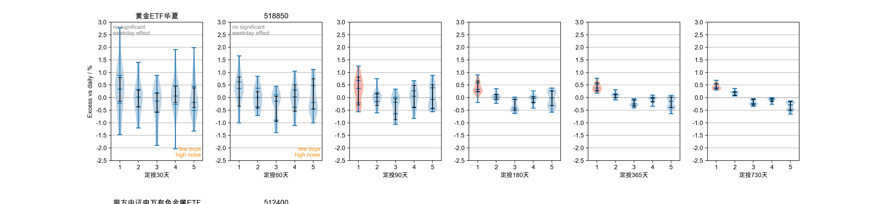

# 回测与算法

本文介绍 ChickenFarm 的定投（AIP, Automatic Investment Plan）回测方法、内置算法原理，以及如何解读输出的小提琴图。

> 这里实现的定投方法仅为一种“最简单的思路”，抛砖引玉，不构成投资建议。历史回测不代表未来收益。

## 一、核心思想

定投的最终收益对**买入区间与结束时点**非常敏感，只取单一日期算一个结果具有很强的偶然性。ChickenFarm 的做法是：在历史上构造大量彼此可比的「情景」，每个情景都是一次完整的定投，再用分布图看「周几买入」对结果的真实影响。

一个情景由一个**估值日 C（Mark Day）**定义，分三步：

```
                    N 个完整交易周（买入窗口）
  ┌──────────────────────────────────────────────┐
  │  周一 … 周五 │  周一 … 周五 │ … │ 周一 … 周五 │
  └──────────────────────────────────────────────┘
   ↑                                            ↑
 start（窗口起点）                               C（估值日，盯市，不卖出）
```

1. **采样估值日 C**：在库内历史交易日上每 **5 个交易日**取一个 C（约每周一个）；
2. **取买入窗口**：每个 C 之前取最近 **N 个完整交易周**；不足 N 个完整周的情景标记为样本不足（`sample_insufficient=1`），**不与满 N 情景混用**；
3. **模拟定投并盯市**：在窗口内分别模拟「每周固定一天买入」（周一~周五 5 组）与「每日买入（daily）」，全程不卖出，在 C 日用当日价格对全部持仓**盯市**。

收集窗口内所有 C 的收益率样本后，默认以**配对超额口径**用小提琴图展示分布，并做配对显著性检验与分块 bootstrap 置信区间。

### 两个口径

| 口径 | 定义 | 用途 | 配置 |
| :-- | :-- | :-- | :-- |
| **excess（默认）** | 同一 C 下「工作日收益 − daily 收益」 | 比较周几优劣（剔除市场 β） | `plot_metric: excess` |
| absolute | C 日盯市的绝对收益率 | 看定投的绝对盈亏水平 | `plot_metric: absolute` |

| 估值日窗口 | 定义 | 配置 |
| :-- | :-- | :-- |
| **近期窗口（默认 1 年）** | 只取「最后一个 C 往前 1 年」内的 C | `recent_years: 1` |
| 全历史 | 使用库内全部历史 C | `recent_years: 0` |

> **为什么默认是「excess + 近 1 年」？**
> 绝对收益率主要由市场 β 决定：以黄金 ETF 518850 为例，定投730天的周一绝对收益在全历史 C 上跨 **-0.6%~+73%**（C 落在 2022 年仅约 +13%、落在 2026 年可达 +73%），而周一到周五的中位数差异只有约 0.1~0.3%——周几效应在绝对口径下完全被市场涨跌淹没。
> 把每个 C 减去同一 C 的 daily 基准后，公共的市场 β 被抵消，分布收窄到约 ±1%，周几谁高谁低立刻可辨；再把 C 限制在最近 1 年，收益预期也与当下市场环境贴合。

## 二、回测流程（最新算法）

入口为 [backtest_mod.py](../src/module/backtest_mod.py) 的 `AutomaticInvestmentPlan.analysis_realtime`，对每只基金、每个周期执行：

1. 由周期标签确定买入窗口的完整周数 N；
2. 取库内全部交易日 `trading_days`，按步长 5 等间隔采样：`mark_days = trading_days[::5]`；
3. 对每个 C，`Algorithm.prepare_data(C, N)`：
   - 在 C 之前的交易日中识别全部「完整交易周」；
   - 完整周数 ≥ N：取最近 N 周，`sample_insufficient=0`；
   - 完整周数 < N：取全部可用周，`sample_insufficient=1`（仍入库，供读取侧过滤）；
4. `StupidAlgorithm` 计算窗口内各分组在 C 日的盯市收益率：
   - `invest_weekly()` → 周一~周五 5 组（每组 N 笔）；
   - `invest_daily()` → daily 基准（5N 笔）；
5. 结果写入 `db_backtest.tbl_<code>`；绘图与统计读取时依次应用**近期窗口过滤 → 满 N 过滤**。

### 读取侧的统一口径

[ aip_plot.py](../src/plot/aip_plot.py) 中所有数据入口只经过一个函数：

```python
def analysis_scenarios(df):
    # 1) 近期窗口：以最后一个 mark_day 为锚点，只保留 recent_years 年内的 C
    # 2) 满 N 过滤：只保留 sample_insufficient == 0 的情景
    return eligible_scenarios(recent_scenarios(df))
```

- 过滤在**整只基金层面**进行，保证同一只基金 6 个周期共用同一批 C 与同一个锚点；
- 过滤后某基金×周期的满 N 配对情景数 < **8**（`MIN_SCENARIOS`）时：子图不画小提琴，灰底占位并标注 `insufficient full-window scenarios`，不做检验、不出 CI、不进 stats CSV，也不参与该行纵坐标统一。

## 三、周期与窗口

周期标签与买入窗口完整周数 N（N = round(cycle/7)）在 [backtest_mod.py](../src/module/backtest_mod.py) 中定义：

```python
InvestmentCycles = [30, 60, 90, 180, 365, 730]          # 展示标签（自然日）
WeeksPerCycle   = {30: 4, 60: 8, 90: 13, 180: 26,
                   365: 52, 730: 104}                   # 各周期完整交易周数 N
MarkDayInterval = 5                                     # 估值日采样步长（交易日）
```

「**完整交易周**」指周一至周五 5 个工作日全部为交易日；节假日导致任一工作日休市的整周剔除。这保证周一~周五 5 组在**同一组周内都有买入、扣款笔数严格相等（均为 N）**，组间唯一差异就是「买在周几」。

- 30/60 天短周期每组仅 4~8 笔扣款，噪声大，图上标注 `few buys high noise`；
- 上市时间短的标的在长周期下可能没有足够的满 N 情景（如 518850 的数据始于 2020-06，第一个满 104 周的 C 要等到 2022-10），对应子图灰显占位。

### 估值日数量

估值日数量不固定，约等于「窗口内交易日总数 ÷ 5」：

```
C 总数 ≈ 交易日总数 / MarkDayInterval
```

以 518850（全历史约 6.3 年）为例：

| 范围 | C 数量 | 说明 |
| :-- | :-- | :-- |
| 全历史采样 | 305 | 2020-06 ~ 2026-09 |
| 其中满 104 周 | 192 | 2022-10 起，每年约 48~49 个 |
| **默认（满104周 ∩ 近1年）** | **49** | 2025-09-25 ~ 2026-09-23 |

## 四、标的类型与下单口径

`FundTypeTools`（[tools.py](../src/util/tools.py)）按 6 位代码前缀区分类型（沪市 51/56/58、深市 15/16 为 ETF，其余为场外基金），也可用 `BACKTEST.fund_type_overrides` 强制指定。两类标的的下单模型在 [algorithm.py](../src/algorithm/algorithm.py) 中分流：

| 口径 | 场外基金 fund | 场内 ETF etf |
| :-- | :-- | :-- |
| 每期买入 | 固定金额（默认 1000 元） | 固定手数（默认 1 手 = 100 份，`etf_lots` 可配） |
| 成交价格 | 累计净值 `totvalue` | 前复权收盘价 `adj_close` |
| 买入份额 | 金额 / 买入价 | 手数 × 100 |
| 成本 | 金额 ×（1 + 申购费率 × 折扣） | 份额 × 买入价 ×（1 + 佣金率） |

- 买入价 = 收盘价 ×（1 + `spread` + `slippage`），默认尾盘价差万 5、佣金 0、滑点 0；
- 场外申购费率取清单中采集的 `buy_rate` × `fund_fee_discount`（默认一折 0.1）；
- ETF 日线由 [etf_mod.py](../src/module/etf_mod.py) 采集（新浪主源、akshare 兜底，指数退避重试），再由 [etf_adjust.py](../src/module/etf_adjust.py) 基于现金分红与可选拆分因子递推前复权价。

## 五、计算公式

### 5.1 一笔下单

设该日成交口径价格为 p（场外基金为累计净值，ETF 为前复权收盘价），实际买入价：

```
buy_price = p × (1 + spread + slippage)
```

- **fund（固定金额 A）**：

```
shares = A / buy_price
cost   = A × (1 + buy_rate × fund_fee_discount)
```

- **ETF（固定手数 L，1 手 = 100 份）**：

```
shares = L × 100
cost   = shares × buy_price × (1 + commission)
```

### 5.2 一个工作日分组的盯市收益率

工作日 w 在 N 个完整周内买入 N 笔，累计份额与累计本金，C 日价格为 p_C（全程不卖出，仅盯市）：

```
              p_C × Σ shares_i − Σ cost_i
profit_w  =  ─────────────────────────────
                      Σ cost_i
```

daily 基准同理，只是在 5N 个交易日上每笔都买：

```
              p_C × Σ shares_j − Σ cost_j
profit_daily = ─────────────────────────────
                       Σ cost_j
```

### 5.3 配对超额（默认绘图口径）

同一 C 下，工作日 w 相对 daily 的超额：

```
excess[C, w] = profit[C, w] − profit[C, daily]
```

**为什么这样能剔除市场 β？** p_C 同时出现在 profit_w 与 profit_daily 中，是该情景下各分组的公共因子；相减后市场整体涨跌（β）被抵消，差值只反映「把买入集中在每周 w，而不是分散到每天」的边际影响。

对固定金额 fund，可进一步化简为平均成本比较（份额 = A/买入价）：

```
profit_w = p_C / avg_buy_w − 1,   avg_buy_w = N × A / Σ shares_i   # 调和均价
excess[C, w] = p_C × (1/avg_buy_w − 1/avg_buy_daily)
```

对固定手数 ETF（份额固定为 L×100）：

```
profit_w = p_C / avg_buy_w − 1,   avg_buy_w = (1/N) Σ buy_price_i  # 算术均价
```

即「平均买入价越低，盯市收益越高」，而超额衡量的就是各工作日平均买入价的相对高低。

### 5.4 数值示例：518850 定投730天（近1年，n=49）

| 工作日 | 超额中位数 | 超额范围 |
| :-- | --: | :-- |
| **周一** | **+0.41%** | +0.30% ~ +0.69% |
| 周二 | +0.20% | +0.06% ~ +0.36% |
| 周三 | -0.23% | -0.35% ~ -0.04% |
| 周四 | -0.08% | -0.26% ~ 0.00% |
| 周五 | -0.29% | -0.66% ~ -0.13% |

周一在全部 49 个近期 C 上稳定优于 daily（超额均为正），周五稳定劣于 daily。

## 六、显著性检验与稳健性

仅比较中位数大小会把噪声误判为「最佳定投日」。[significance.py](../src/algorithm/significance.py) 做了三层统计，全部只使用过滤后的满 N 情景：

1. **配对 Wilcoxon 符号秩检验**：以 C 为配对键，对周一~周五全部 10 个配对做检验，报告效应量 r = z/√n；p 值经 **Holm 多重比较校正**。由于工作日两两差值对「逐行减同一 daily 常量」不敏感，检验在 excess 与 absolute 口径下结果相同；
2. **分块 bootstrap 中位数 95% CI**：相邻 C 的买入窗口高度重叠（730 周期相邻 C 仅差 5 个交易日，窗口重叠约 99%），把每个 C 当独立样本的 i.i.d. 重采会虚假地得到过窄 CI。现采用**移动分块 bootstrap（moving-block bootstrap）**：每次随机抽取长度为 L 的连续 C 块拼接、1000 次重采，保留块内时间结构与组间配对关系。

```
L = min(N, max(1, n // 4))        # N=周期完整周数，n=过滤后情景数；L=1 即 i.i.d. bootstrap
```

3. **分时间块稳健性**：把 C 按时间先后切 4 块，逐块判定 best day；同一工作日在 ≥ 60% 的块中占优才判为稳健。

**标红规则**：某工作日相对其余 4 个工作日中**至少 3 个**，收益方向一致更高且 Holm 校正后 p < 0.05，并通过分块稳健性判定，才在图上标红；否则左上角标注 `no significant weekday effect`。

## 七、示例图

### 518850 定投730天：配对超额特写

默认口径（excess + 近1年）下，周一~周五的超额分布与 0 基准（灰色虚线，即 daily）：


- 周一（红色，显著且稳健占优）整把小提琴在 0 线上方；周五整把在 0 线下方；
- 黑色误差线为中位数分块 bootstrap 95% CI；小提琴内横线自上而下为 75% 分位、中位数、25% 分位，顶端/底端短横线为极值。

### 518850 六个周期全景

同一只基金在 30/60/90/180/365/730 天各周期下的超额分布（同一行纵坐标统一，含 0 基准）：



- 周期越长（越往右）每组扣款笔数越多，分布越收敛、周几排序越稳定；
- 30/60 天右下角橙色提示 `few buys high noise`，左上角灰色提示此时无显著效应。

## 八、小提琴图解读

绘图核心为 [aip_plot.py](../src/plot/aip_plot.py) 的 `export_aip_violin_plot_by_filed`，按**领域**分别出图：

- **每一行**：一只基金在 6 个周期上的回测分析，同一行纵坐标刻度完全一致，便于横向比较；
- **每一列**：同一周期下不同基金的结果；
- **excess 口径（默认）**：周一~周五共 5 把小提琴，纵轴为相对 daily 的配对超额（%），**y=0 灰色虚线即 daily 基准**；
- **absolute 口径**：周一~周五 + 金色 daily 共 6 把小提琴，纵轴为绝对盯市收益率，宽度由市场 β 主导；
- **小提琴宽窄**：概率密度——越宽表示越多 C 落在该收益率附近。

配色与标注：

- absolute 下 daily 染金色；excess 下以 y=0 灰虚线表示 daily；
- 显著且稳健占优的工作日标红；
- 短周期右下角 `few buys high noise`；无显著效应左上角 `no significant weekday effect`；
- 满 N 情景不足 8 个的子图灰底占位 `insufficient full-window scenarios`。

图表保存到 `EXPORT_AIP_PLOT_PATH/<日期>/<领域>.png`；同级 `stats/` 目录另有 3 份 CSV：`<领域>_pairwise.csv`（配对检验）、`<领域>_ci.csv`（分块 bootstrap CI，含 `group/median/ci_low/ci_high/metric`，excess 下 group=-1 的 daily 行恒为 0）、`<领域>_stability.csv`（分块稳健性）；`bootstrap: false` 时不产出 CI CSV。

## 九、配置项一览

`BACKTEST` 下全部可选项（缺省时使用括号内默认值）：

| 配置 | 默认 | 说明 |
| :-- | :-- | :-- |
| `etf_lots` | 1 | ETF 每期买入手数（1手=100份） |
| `spread` | 0.0005 | 尾盘买入相对价差（万5） |
| `commission` | 0 | ETF 佣金率（免5账户可设0） |
| `slippage` | 0 | 滑点 |
| `fund_fee_discount` | 0.1 | 场外申购费率折扣（一折） |
| `significance_test` | true | 配对显著性检验（false 回退裸中位数选最优日） |
| `bootstrap` | true | 分块 bootstrap CI 误差线（false 同时不产出 CI CSV） |
| `plot_metric` | excess | excess=配对超额 / absolute=绝对收益率 |
| `recent_years` | 1 | 估值日近期窗口年数（0=全部历史） |
| `export_stats` | true | 导出 stats CSV |
| `fund_type_overrides` | {} | 强制指定个别代码类型 |
| `split_factors` | {} | ETF 拆分因子 |

## 十、局限与注意事项

- 回测基于历史净值/行情，**历史表现不代表未来收益**；
- 对齐持有窗口后，A 股周一~周五的真实周几差异很小（实测中位数差约 0.1~0.3%），多数标的多数周期并不显著；本工具更适合验证「周几差异确实很小、不必纠结」，而非选出神奇扣款日；
- absolute 口径下分布宽度主要反映市场 β，不能用小提琴绝对位置判断周几优劣，请使用默认 excess 口径；
- 结果对周期、完整周数量与数据完整性敏感，基金成立时间较短时可用情景减少；
- 模型对成交价、费用与复权做了简化近似（尾盘价差、固定费率、现金分红递推），未模拟申赎确认与到账延迟；
- 多进程采集/回测对数据库连接数有要求，建议将 MySQL `max_connections` 调到 500 左右；
- ETF 日线采集多进程并发默认限制为 4，避免触发数据源限流。

## 附：如何扩展新算法

1. 在 [src/algorithm/](../src/algorithm/) 中新增类，继承 `Algorithm`，实现 `invest_weekly`（可复用 `prepare_data`、`place_order`）；
2. 在 [backtest_mod.py](../src/module/backtest_mod.py) 中新增 Plan 类，工厂方法 `create_algo` 返回新算法；
3. 在 [transport_mod.py](../src/module/transport_mod.py) 的 `_upload_backtest_data` 中把新 Plan 加入 `aip_plans` 列表即可参与回测。
